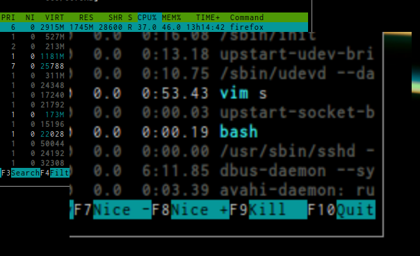

## magnifier

[magnifier](https://github.com/minos-org/magnifier/) is a free, open source, cross-platform screen magnification tool. This is the source of Virtual Magnifying Glass, frozen at svn r254 of [sourceforge](http://magnifier.sourceforge.net/); minos builds it with Free Pascal and Lazarus ([magnifier-deb](https://github.com/minos-org/magnifier-deb) carries the packaging and its patches).

<p align="center">

</p>

## Quick start

### On Ubuntu (only LTS releases)

1. Set up the minos archive:
   ```
   $ sudo add-apt-repository ppa:minos-archive/main
   ```
   
2. Install:
   
   ```   
   $ sudo apt-get update && sudo apt-get install magnifier
   ```
   
3. Enjoy ☺!

### From source

1. Install Free Pascal and Lazarus (`fpc lcl-utils lcl-units lcl-gtk2 libgtk2.0-dev` on Ubuntu)

2. Build: `lazbuild --build-all --ws=gtk2 magnifier.lpi`

3. Launch `./magnifier`
